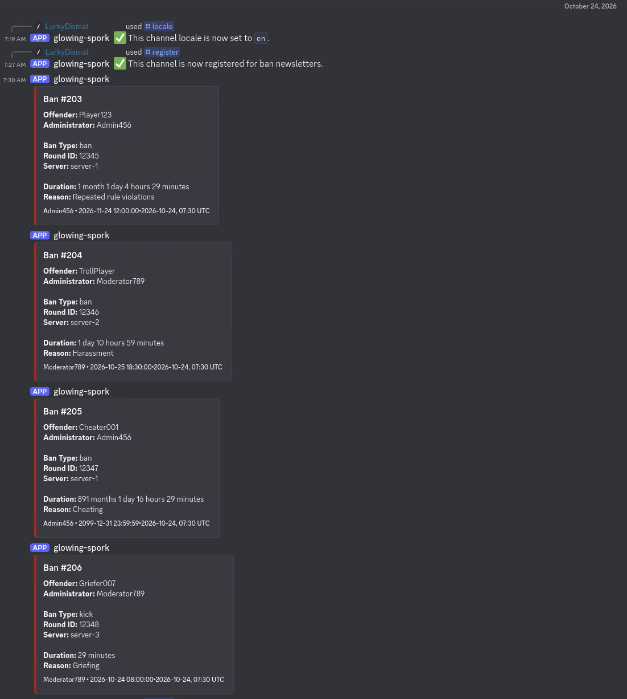
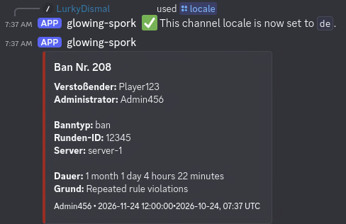
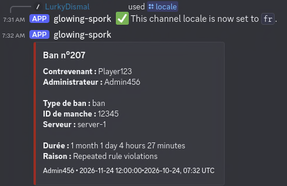

# glowing-spork

> A configurable Rust Discord bot that publishes localized ban announcements from PostgreSQL events.

## Table of Contents

- [General Information](#general-information)
- [Technologies Used](#technologies-used)
- [Features](#features)
- [Screenshots](#screenshots)
- [Setup](#setup)
- [Usage](#usage)
- [Configuration](#configuration)
- [Ban Table Integration](#ban-table-integration)
- [Project Status](#project-status)
- [Room for Improvement](#room-for-improvement)
- [Acknowledgements](#acknowledgements)
- [License](#license)

## General Information

`glowing-spork` monitors a PostgreSQL ban table and sends Discord embed messages when bans are added or edited. It is designed to integrate with an existing server database: the ban table and its column names can be configured without changing the source code.

Channel registrations and their locale preferences are stored separately in SQLite.

## Technologies Used

- Rust 2024 edition
- Tokio for asynchronous runtime and tasks
- Poise and Serenity for Discord slash commands and API integration
- SeaORM with PostgreSQL and SQLite support
- PostgreSQL notifications and triggers for ban events
- `quick-xml` for parsing customizable embed templates
- `dotenvy` for loading environment variables from `.env`
- Docker and Docker Compose configuration files
- `just` for common build and development tasks

## Features

- Detects inserted and updated ban records through PostgreSQL triggers and notifications.
- Publishes and updates localized Discord embed messages for registered channels.
- Supports per-channel registration and locale overrides.
- Provides Discord slash commands to register or unregister the current channel and change its locale.
- Stores channel registrations and locale preferences in SQLite.
- Supports configurable ban table and column names.
- Supports custom XML embed templates, including multiple languages.
- Watches a configured XML template file and reloads it when it changes.
- Allows event filtering through the `EVENT_NAMES` environment variable.
- Can ask for confirmation before creating the database objects needed for event notifications, or automatically approve those changes for non-interactive deployments.

## Screenshots





## Setup

### Prerequisites

- A Rust toolchain that supports the 2024 edition
- A PostgreSQL database containing the ban table to monitor
- A Discord bot token, with the bot invited to your server and permission to use application commands
- SQLite support for the local newsletter database (handled by the application through SeaORM)
- Optional: [`just`](https://github.com/casey/just) to use the included recipes

### Configure the environment

Create a local environment file:

```bash
cp env.example .env
```

Review `.env` and configure your database, authentication settings.

The application reads `.env` automatically when starting. Do not commit real tokens, passwords, or other secrets.

### Build and run

From the project root, run:

```bash
cargo run --release
```

To build without starting the bot:

```bash
cargo build --release
```

The project also includes `just` recipes, including `just run-release` and `just build-release`.

On first startup, the application checks for the PostgreSQL objects it needs. If an object is missing, it asks for confirmation before creating it. Set `AUTO_CONFIRM_SCHEMA_CHANGES=true` to approve those changes automatically; use this only when you intend to allow the application to modify the database schema.

## Usage

After the bot starts and its slash commands are available in Discord, use:

- `/register` — register the current channel to receive ban announcements.
- `/unregister` — stop sending announcements to the current channel.
- `/locale` — set the current channel's locale override. Available locale choices are derived from the embed template.

Configure `EVENT_NAMES` to select which events are published. It accepts notification channel names (`ban_added`, `ban_edited`), event values (`added`, `edited`), or a mixture of them. Separate values with commas or whitespace. For example:

```dotenv
EVENT_NAMES=added,ban_edited
```

## Configuration

| Variable                      | Required | Description                                                                                                                          |
| ----------------------------- | -------- | ------------------------------------------------------------------------------------------------------------------------------------ |
| `DATABASE_URL`                | Yes      | PostgreSQL connection URL for the source ban table and event listener.                                                               |
| `NEWSLETTER_DATABASE_URL`     | Yes      | Connection URL for the database that stores Discord channel registrations; SQLite is the intended configuration.                     |
| `DISCORD_TOKEN`               | Yes      | Token for the Discord bot.                                                                                                           |
| `EVENT_NAMES`                 | Yes      | Events to publish: `ban_added`, `ban_edited`, `added`, and/or `edited`.                                                              |
| `EMBED_FILE`                  | No       | Path to a custom XML embed template. If omitted, a built-in template is used. Configured files are watched for changes and reloaded. |
| `AUTO_CONFIRM_SCHEMA_CHANGES` | No       | Set to `true` or `1` to skip confirmation prompts when creating missing database objects. Defaults to prompting.                     |
| `BANS_TABLE`                  | No       | Source table name, optionally schema-qualified. Defaults to `bans`.                                                                  |
| `BANS_COL_ID`                 | No       | Ban ID column. Defaults to `id`.                                                                                                     |
| `BANS_COL_INTRUDER`           | No       | Offender column. Defaults to `intruder`.                                                                                             |
| `BANS_COL_ADMIN`              | No       | Administrator column. Defaults to `admin`.                                                                                           |
| `BANS_COL_TYPE`               | No       | Ban type column. Defaults to `type`.                                                                                                 |
| `BANS_COL_ROUND_ID`           | No       | Round ID column. Defaults to `round_id`.                                                                                             |
| `BANS_COL_SERVER`             | No       | Server name column. Defaults to `server`.                                                                                            |
| `BANS_COL_CREATED_AT`         | No       | Creation timestamp column. Defaults to `created_at`; the application can add this column if it is missing.                           |
| `BANS_COL_DURATION_END`       | No       | Ban expiry timestamp column. Defaults to `duration_end`.                                                                             |
| `BANS_COL_REASON`             | No       | Ban reason column. Defaults to `reason`.                                                                                             |

## Ban Table Integration

By default, the application expects an existing PostgreSQL table named `public.bans` with these columns:

| Column         | Expected data                                           |
| -------------- | ------------------------------------------------------- |
| `id`           | Integer ban ID                                          |
| `intruder`     | Offender identifier or name                             |
| `admin`        | Administrator identifier or name                        |
| `type`         | Ban type                                                |
| `round_id`     | Round ID                                                |
| `server`       | Server name                                             |
| `duration_end` | Ban expiry timestamp                                    |
| `reason`       | Ban reason                                              |
| `created_at`   | Creation timestamp; added by the application if missing |

If your table uses different names, set the corresponding `BANS_COL_*` variables. For example, for a table named `public.ban_records` with columns `ban_id`, `target_ckey`, `banned_by`, `ban_type`, `round_ref`, `server_name`, `created_at`, `expires_at`, and `ban_reason`, configure:

```dotenv
BANS_TABLE=public.ban_records
BANS_COL_ID=ban_id
BANS_COL_INTRUDER=target_ckey
BANS_COL_ADMIN=banned_by
BANS_COL_TYPE=ban_type
BANS_COL_ROUND_ID=round_ref
BANS_COL_SERVER=server_name
BANS_COL_CREATED_AT=created_at
BANS_COL_DURATION_END=expires_at
BANS_COL_REASON=ban_reason
```

The application creates the `ban_event_type` enum, the `ban_events` queue table, the `notify_ban_events()` trigger function, and a trigger on the configured ban table when these objects are missing. The trigger handles `INSERT` and `UPDATE` operations and emits the `ban_added` and `ban_edited` PostgreSQL notifications.

### Custom embed templates

The included [`embed.xml`](embed.xml) demonstrates templates for Russian, English, French, and German. Set `EMBED_FILE` to point at your own XML file. Text fields can use placeholders such as `{id}`, `{intruder}`, `{admin}`, `{type}`, `{round_id}`, `{server}`, `{created_at}`, `{duration_end}`, `{date}`, `{time}`, `{date_time}`, `{time_left}`, `{reason}`, and `{reason_display}`. See the XML file for examples of titles, colors, lines, groups, and footers.

## Project Status

Project is: _in progress_.

## Room for Improvement

Potential areas for improvement:

- Add more automated tests for PostgreSQL event handling and end-to-end Discord delivery.
- Document additional embed-template examples and validation rules.
- Provide deployment examples for common server environments.

## Acknowledgements

- Built with the Rust ecosystem and the libraries listed in [`Cargo.toml`](Cargo.toml).

## License

This project is open source and available under the [GNU Affero General Public License v3.0](LICENSE).
